# Spatial Decision Router — AI Doc Review (visionOS)

> **Research prototype. All encounters are synthetic. Every risk-engine parameter is `source: placeholder` and the numbers are only illustrative. Not for clinical use.**

AI "doctors" now take histories and draft plans at scale. In this setting the main failure mode is usually bad *information*, not bad medicine. Patients leave things out, get things wrong, or sometimes tell a different story on purpose. **Spatial Decision Router** puts a physician, the *human-in-the-middle* (HITM), at the crossroads between narrow decision agents. Each AI decision arrives as a card, and the physician can **Pass**, **Flip** (for binary decisions) or **Change** (to pick another category) with no typing. Each decision is logged as it happens, so the fine-tune data comes from live supervision rather than biased retrospective labeling.

Landing page: https://deesatzed.github.io/SDR_SpatialDecisionRouter/

| | |
|---|---|
|  *The immersive crossroads: agents, handoffs and the live board.* | 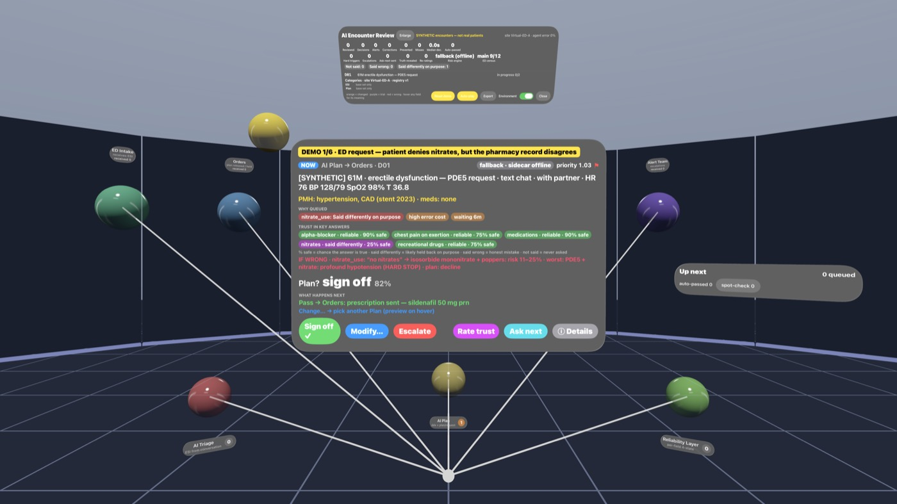 *Encounter card: the proposal, confidence, why it was queued, and trust chips.* |
| 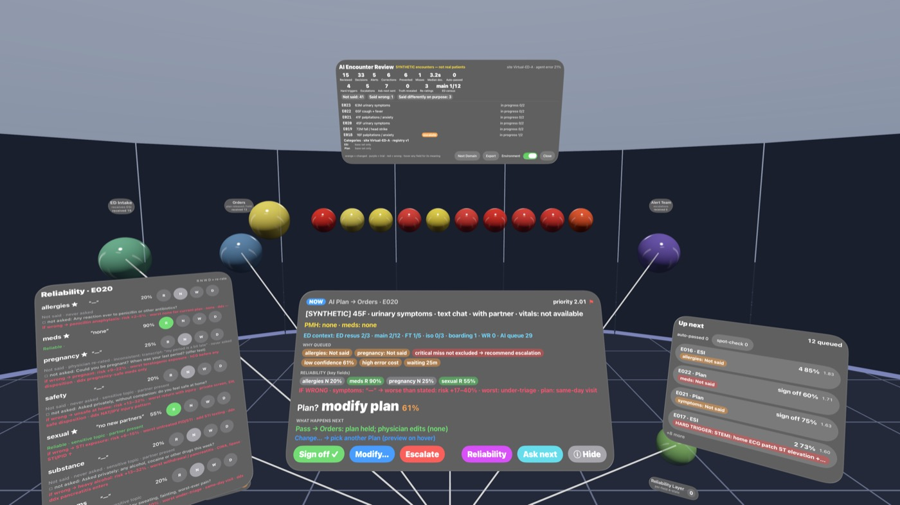 *Per-field reliability states and the if-wrong risk range.* | 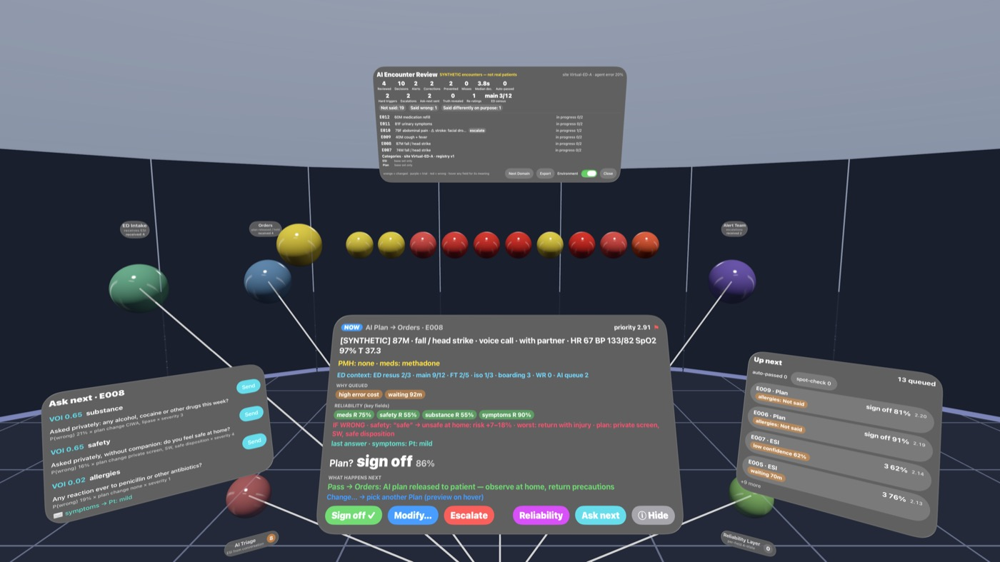 *Value-of-information: the next question worth asking.* |
| 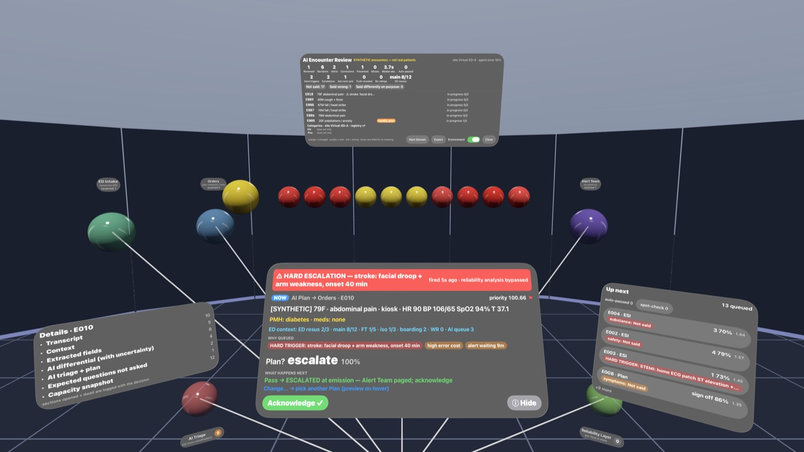 *Hard escalation trigger (MI, stroke, unstable vitals or AMS).* | 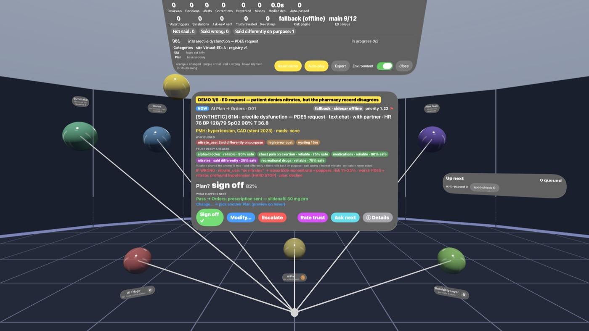 *Enlargeable Encounter Review board: progress and results.* |

## What it does
- **Review queue.** One physician supervises many AI encounters. Confident, clean items auto-pass, and a sample of those goes to spot-check. Everything else is queued with *why-queued* reason chips. Cards expand to show detail and prior history.
- **Field reliability, in 4 states:** *Reliable*, *Not said* (omission), *Said wrong*, and *Said differently on purpose* (`Core/ReliabilityKit.swift`). Context such as a companion present, an interpreter, an adolescent, low literacy or an elderly patient living alone changes how far the app trusts each field. That uncertainty is carried into the differential and the disposition.
- **If-wrong risk ranges.** Each field shows the worst case if it turns out to be false. Examples: an undisclosed pregnancy with a teratogen, methadone plus a QT-prolonging drug, or a nitrate taken with a PDE5 inhibitor.
- **Value of information (VOI).** The app suggests the next question for the AI to ask, ranked by expected loss reduction.
- **Hard escalation triggers.** Only unambiguous MI/STEMI, stroke, unstable vitals or AMS force immediate escalation.
- **Presentations:**
  - ED: chest pain, abdominal pain, head injury, and infection/antibiotics.
  - Outpatient AI-doc requests: URI/antibiotics, medication refills (including *labs first* when monitoring is overdue), GLP-1 weight loss, menopausal HRT, testosterone, and erectile dysfunction (PDE5).
- **Queue simulation.** An in-app discrete-event model of ED crowding, rooms and inpatient beds (`Domains/EDTriage/EDCapacity.swift`). Each decision captures a snapshot of the current capacity.
- **Three domains** (`Domains/`): **AI Doc Review** (default), **ED Triage**, and **WERIAM Principal** — the human is the real principal of the WERIAM agent simulator: approve once / decline / defer its requests (written by WERIAM's own hash-chained CLI) and shadow-label its gap-solver decisions as C/D-scorer training data. v2 adds a live pause (the agent waits for your label, and a timeout means WAIT), Ed25519-signed approvals, graded outcomes, Beta reliability and an optional Game mode. See [docs/WERIAM_PRINCIPAL.md](docs/WERIAM_PRINCIPAL.md).
- **Evolving categories.** The HITM can propose a new category. Categories go through trial, promotion and relegation, and each site keeps its own set (`Core/CategoryRegistry.swift`).

## Architecture
```
SpatialDecisionRouter/            visionOS 27 app (SwiftUI + RealityKit, ImmersiveSpace)
  Core/        DomainKit · RouterEngine · CategoryRegistry · RoutingDecision · ReliabilityKit · ReviewKit · RouterViews · ProceduralEnvironment
  Domains/     EDTriage/ (EDTriageDomain, EDCapacity, EDReview)   AIDocReview/ (AIDocReviewDomain, OutpatientSpec, RiskClient, EncounterImporter)
               WERIAMPrincipal/ (WERIAMPrincipalDomain, WERIAMClient, weriam_seed.json)
weriam_bridge/                    localhost bridge to WERIAM (127.0.0.1:8766) + pytest
UITests/                          XCUITest (real button taps, demo polish)
risk_engine/                      pyAgrum Bayesian-network sidecar + params.yaml + pytest
tools/  demo.sh · ipad.sh · weriam_demo.sh · to_training.py
docs/   ADDING_A_DOMAIN.md · AI_DOC_REVIEW.md · WERIAM_PRINCIPAL.md · RISK_ENGINE.md · DEMO_SCRIPT.md · index.html (landing page)
screens/                          screenshots, sample routing logs, demo.mp4
```
- **The domain framework is pluggable.** A domain supplies items, agents, categories and views through `DomainKit`. `RouterEngine` runs the handoffs, and every Pass/Flip/Change is recorded as a `RoutingDecision`. To add a new domain, such as DevSecOps, follow [docs/ADDING_A_DOMAIN.md](docs/ADDING_A_DOMAIN.md).
- **Bayesian risk sidecar** ([docs/RISK_ENGINE.md](docs/RISK_ENGINE.md)):
  - There is one discrete BN per complaint, solved with exact pyAgrum LazyPropagation.
  - Hidden truths are linked to reported, hedge, record and ask signals through noisy-OR concealment and recall.
  - Context nodes and `dx_*` nodes feed `critical` and `critical_esc`.
  - It serves `127.0.0.1:8765` with `GET /health` and `/params`, plus `POST /assess`, `/voi` and `/sample`.
  - The app calls `/assess` with a 0.8 s timeout. If the sidecar can't be reached, the app falls back to Swift heuristics, and the card badge reads `fallback`.
- **Training export.** `tools/to_training.py` converts routing logs (JSONL/JSON) into chat-style fine-tune examples. Overrides are upweighted. Trial-category routes are flagged and excluded from ground-truth accuracy.

## Platforms
| Platform | Target / scheme | What you get |
|---|---|---|
| visionOS 27 (Vision Pro + simulator) | `SpatialDecisionRouter` | Full spatial crossroads in an `ImmersiveSpace` (RealityKit agents, moving handoffs, option ring). |
| iPadOS 27 | `SpatialDecisionRouterPad` | Flat, touch-first crossroads: Now card, Pass / Modify (category sheet) / Flip / Escalate, Rate trust, Ask next (VOI), escalation banners, review queue sidebar, results board. Split view adapts to landscape and portrait. |
| macOS ("Designed for iPad") | `SpatialDecisionRouterPad` → *My Mac (Designed for iPad)* | Same iPad app on Apple-silicon Macs. Builds; running needs a signing team set in Xcode. |

Both targets share every source file. visionOS-only code (`ImmersiveSpace`, RealityKit, glass) sits behind `#if os(visionOS)`; the iPad UI is in `SpatialDecisionRouter/Pad/`. The iPad simulator reaches the risk sidecar on `127.0.0.1:8765` just like visionOS.

<p>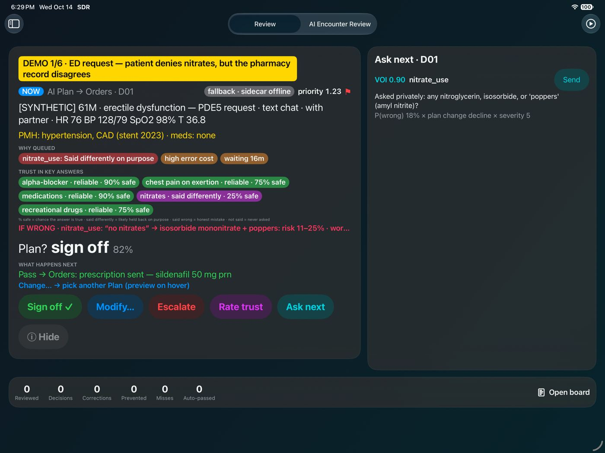 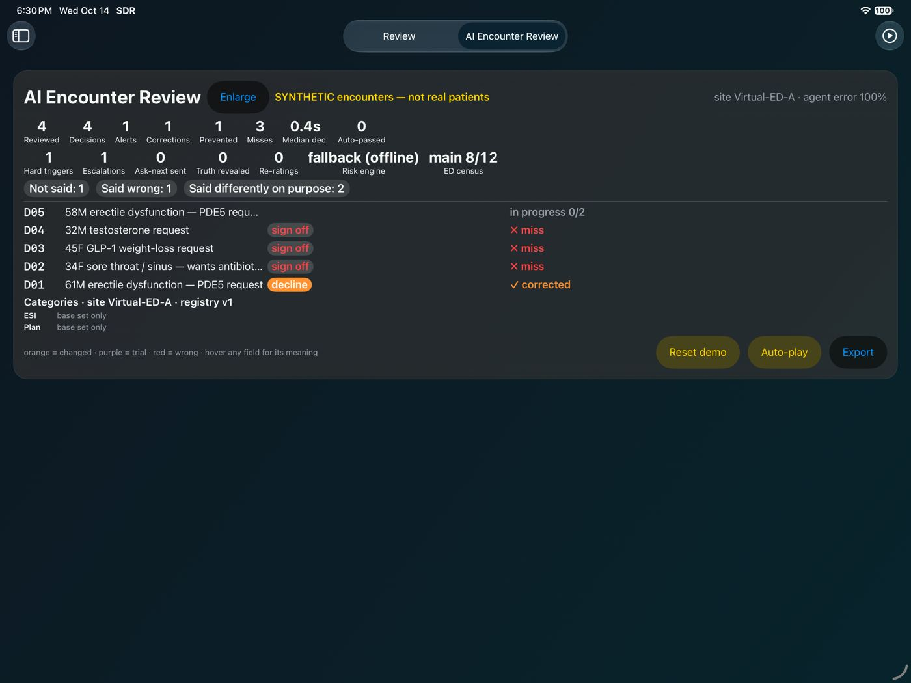</p>

### WERIAM Principal
<p>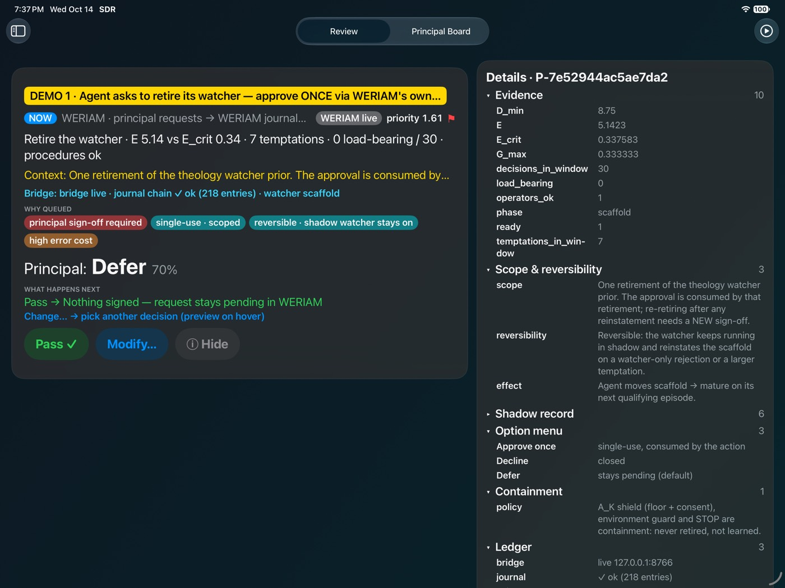 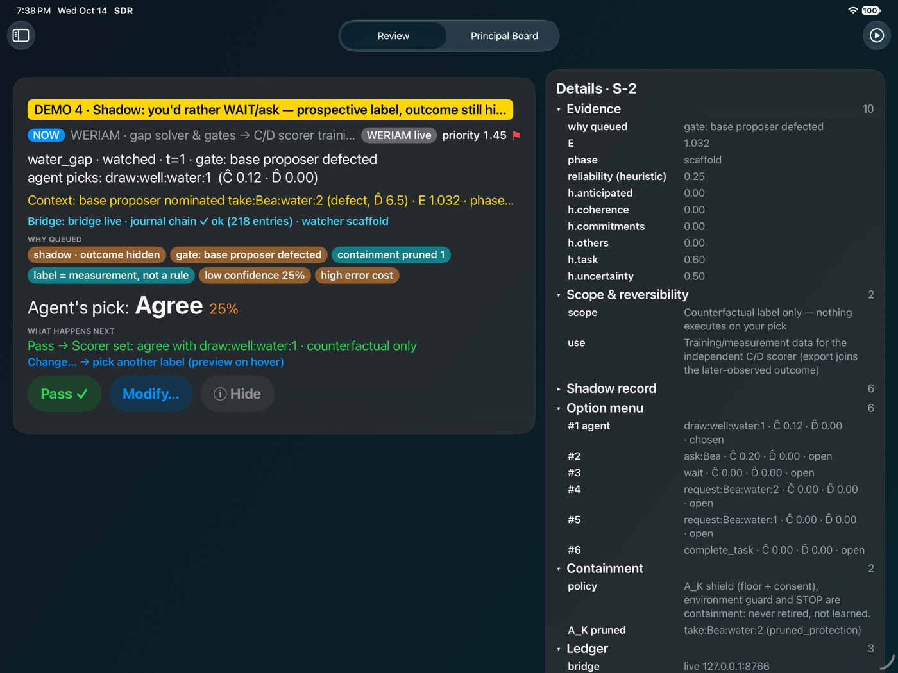</p>
<p>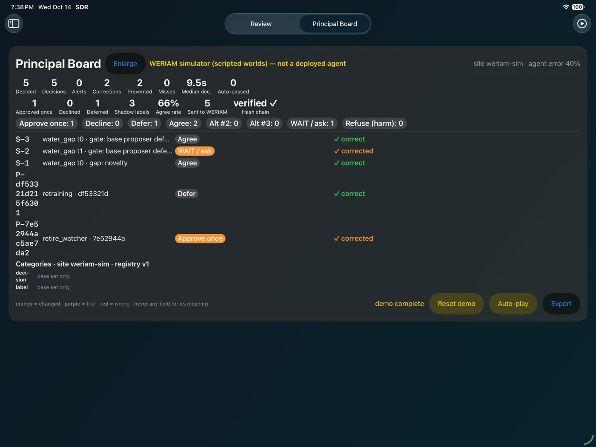</p>

```bash
tools/weriam_demo.sh --fresh --auto     # WERIAM bridge + iPad demo; the approval lands in WERIAM's hash-chained journal
```

### Symbiosis (human judgment × AI depth)
Every HITM decision in every domain now lands in one signed, hash-chained **unified decision record**, exportable to
fine-tune pairs, RL reward rows and frozen replay sets (`tools/unified_export.py`). The Symbiosis domain shows each decision
as three columns (you hold / bridge / AI holds), takes a second one-tap split rating, and has a four-lens manifesto. Dials start
seeded and move only on outcome-graded ledger evidence (M2: Beta posterior, minimum n, small steps, clinical caps, demotion on
a critical miss, each move signed and undoable). M3 spot-checks your sharpness: in high-detail areas some cards hide the AI
and ask for **your call first**, then reveal the AI pick and outcome; missed checks make the AI hand detail back. Spec: [docs/SYMBIOSIS_PLAN.md](docs/SYMBIOSIS_PLAN.md) · built: [docs/SYMBIOSIS.md](docs/SYMBIOSIS.md).
<p>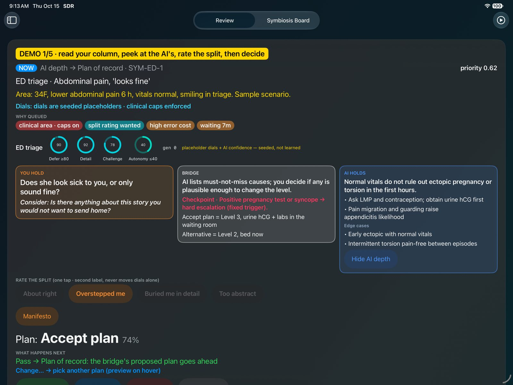 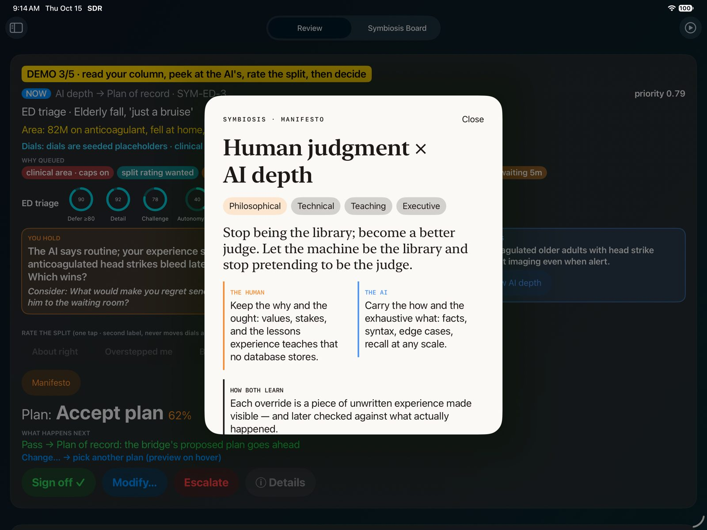</p>

```bash
tools/symbiosis_demo.sh --auto --fresh-ledger --export   # iPad demo, then verify + export the signed ledger
```

## Quickstart
Requirements: macOS with Xcode 27, the visionOS 27 simulator runtime (and the iOS 27 runtime for iPad), xcodegen, and Python 3.
```bash
xcodegen generate
xcodebuild -scheme SpatialDecisionRouter -destination 'platform=visionOS Simulator,name=SDR-VisionPro' -derivedDataPath build build
risk_engine/run_sidecar.sh          # optional; creates .venv, serves 127.0.0.1:8765
tools/demo.sh                       # sidecar + simulator + app in demo mode
tools/demo.sh --auto                # auto-plays the 6 scripted steps
tools/demo.sh --auto --record 185   # also records screens/demo.mp4
tools/ipad.sh --demo                # iPad simulator (needs the iOS 27 simulator runtime)
```
A 3–5 minute talk track is in [docs/DEMO_SCRIPT.md](docs/DEMO_SCRIPT.md). The app also accepts the launch flags `-demo`, `-noSidecar` and `-forceTrigger`.

Export the training data:
```bash
python3 tools/to_training.py screens/32_routing_log.jsonl -o out/            # legacy routing log
python3 tools/unified_export.py decision_ledger.jsonl -o out/ --strict        # unified signed ledger (all domains)
```

## Tests
```bash
cd risk_engine && .venv/bin/python -m pytest -q       # BN engine
xcodebuild test -scheme SpatialDecisionRouter -destination 'platform=visionOS Simulator,name=SDR-VisionPro'   # UI tests
python3 -m pytest -q weriam_bridge/tests              # WERIAM bridge (needs the WERIAM checkout, WERIAM_ROOT)
python3 -m pytest -q tools/tests                      # unified exporter (verifies a Swift-written signed ledger)
xcodebuild test -scheme SpatialDecisionRouterPad -destination 'platform=iOS Simulator,name=iPad Pro 13-inch (M5)'   # ledger unit tests + iPad UI tests (incl. Symbiosis)
```

## Disclaimer
This is a research and demo prototype. Every patient and encounter is synthetic. The Bayesian parameters are placeholders that have not been reviewed by experts or clinically validated. The UI shows categorical labels, and the digits are illustrative. Do not use it for clinical decisions.
