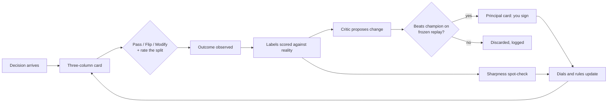

# Symbiosis Plan

Pinned spec for the Symbiosis layer of Spatial Decision Router (SDR).
Written 2026-10-15 so we do not drift. Update this file when the plan
changes; do not invent behavior that contradicts the non-negotiables.

Related: `docs/WERIAM_PRINCIPAL.md`, `docs/ADDING_A_DOMAIN.md`,
`docs/RISK_ENGINE.md`. Background review of the competitor product lives
on the agent box at `/workspace/vosim/symbiont_assessment.md`.

---

## 1. Purpose / thesis

Humans should stop trying to be the library and get better at being the
judge. AI should stop trying to be the judge and get better at being the
library. Both sides learn, context by context, where that line belongs
for this person.

| Side | Holds | Does not hold |
|------|-------|---------------|
| Human | Judgment, values, and **wisdom** (what experience taught that is not knowledge-base driven) | Exhaustive recall, syntax, granular edge cases |
| AI | Scalable depth: facts, syntax, current detail, recall at any scale | Final judgment where values and unwritten experience are the point |

**Functional knowledge** is what the human still keeps in their head: the
shape of a field, which questions matter, what "wrong" smells like, and
enough detail to steer and to catch the AI when it is off. Not nothing,
and not the whole library — a working map.

The line moves with **context** (high-stakes clinical vs. citation
formatting) and with **the person** (expert vs. novice, and as they
grow). Each Pass / Flip / Modify and each split rating teaches both
sides where the line sits for this area of life.

### Risks to guard

- **Skill atrophy.** If the human stops holding detail, can they still
  catch the AI? Needs deliberate sharpness spot-checks.
- **Wisdom vs. bias.** Experience that is not data-backed can be insight
  or prejudice. Overrides are scored against observed outcomes over time.
- **Whose line is it?** Different people, orgs, and cultures draw the
  split differently. Per-context, per-user learning is the core idea,
  not a feature bolted on later.

This is the general theory behind SDR: the human at the crossroads
handles judgment; agents handle depth; every decision teaches both sides
where the line is. ED triage, AI tele-doc, and WERIAM Principal are
instances. Symbiosis is the shared scaffolding.

---

## 2. Non-negotiables (anti-drift)

These are hard. A PR that violates one is out of scope until the plan
is updated and the change is explicit.

1. **Every HITM decision is logged** in the unified decision record
   (Section 4), across every domain.
2. **Rewards are grounded in observed outcomes**, not only in
   self-rating. Satisfaction labels may break ties; they never alone
   promote a rule or raise a dial.
3. **Promotion only if the candidate beats the champion** on a frozen,
   blinded replay of past cases with known outcomes, **and** a human
   signs a Principal card (Approve once / Decline / Defer).
4. **Signed, hash-chained ledger** for approvals, dial changes, and
   promotions. Same spirit as WERIAM Principal.
5. **Hard escalation triggers** and **automatic demotion** of autonomy
   after one critical miss.
6. **Sharpness spot-checks** when the AI is carrying most of the detail
   in a context. Calibration on those checks can lower absorption.
7. **Clinical contexts have dial caps** (autonomy horizon capped;
   deference has a floor). Defaults inherit the clinical seed profile.
8. **LLM critic only proposes.** It never grades itself into production
   and never assigns the Q / score used for promotion.
9. **No invented numbers.** Placeholders are labeled as such. Measured
   gains only appear once measured. Reliability shows sample size.

---

## 3. Scaffolding (five layers)

### Layer 1 — Context

Each area of life (ED triage, tele-doc, WERIAM, personal topics such as
finances) keeps its own **four dials**:

| Dial | Meaning |
|------|---------|
| Deference | How fast the AI defers to the human |
| Detail absorption | How much granular syntax/detail the AI carries |
| Challenge / probe | How hard the AI questions blind spots |
| Autonomy horizon | How far the AI may act before checking in |

Dials move **only through earned autonomy**: rise after N
outcome-verified correct calls; step down after one critical miss.
Clinical contexts start cautious and keep hard caps. Every dial change
is a signed ledger entry.

### Layer 2 — Card

Every decision is shown in **three columns**:

1. **Human holds** (warm orange) — short: the judgment call and maybe a
   question to consider.
2. **Bridge** — the joint decision architecture, boundary checkpoint,
   collaborative workflow.
3. **AI holds** (blue, collapsed by default) — distilled depth, syntax,
   edge cases; one tap to expand.

SDR pieces sit on top of the card: reliability, if-wrong ranges, Ask
next (value of information), and named escalation triggers.

### Layer 3 — Dual labels

Per decision the human gives two labels:

1. **Decision:** Pass / Flip / Modify (and Escalate where applicable).
2. **Split quality** (one tap): about right / overstepped me / buried me
   in detail / too abstract.

Both are later graded against observed outcomes. Split ratings live in
the shadow/label store; they do not silently rewrite agent policy.

### Layer 4 — Gated learning

1. Critic (LLM optional; offline stub by default) **proposes** rule or
   dial changes.
2. Candidate is evaluated on a **frozen, blinded replay** of past cases
   with known outcomes against the current champion.
3. If it wins, a **Principal card** shows a real before/after replay
   diff; the human Approve-once / Decline / Defer.
4. On Approve, change is signed into the ledger and lineage updates.

No self-graded promotion. No "expected gain" until measured.

### Layer 5 — Human sharpness

When detail absorption is high, schedule spot-check cards that **hide
the AI's answer** and ask the human first, then reveal. Calibration on
those checks decides whether absorption may rise further or must fall
back.

### Flow

---

## 4. Unified decision record and exporters

### Schema (one record per HITM decision, all domains)

| Field | Notes |
|-------|-------|
| `id` | Stable unique id |
| `timestamp` | ISO 8601, America/New_York when displayed |
| `domain` | e.g. `ed_triage`, `ai_tele_doc`, `weriam_principal`, `symbiosis:<area>` |
| `context_id` | Area / world / sub-context |
| `dial_snapshot` | Four dials at decision time |
| `generation` | Rule/policy generation number |
| `card_payload` / `card_hash` | Content or content-addressed hash |
| `agent_proposal` | What the agent recommended |
| `human_decision` | Pass / Flip / Modify / Escalate / … |
| `split_rating` | about_right / overstepped_me / buried_me / too_abstract / null |
| `latency_ms` | Time to decide |
| `reliability` | Score + sample size (placeholders labeled) |
| `escalation_flags` | Which hard triggers fired |
| `outcome` | Nullable: value, source, observed_at |
| `signer_key_id` | Key used for signed decisions |
| `signature` | Over the canonical record body |
| `ledger_hash` / `ledger_prev` | Hash chain |

### Exporter outputs (three)

1. **Fine-tune pairs** — SFT and preference (chosen vs. rejected) from
   decision + card context.
2. **RL reward rows** — outcome-graded reward; split rating as auxiliary
   signal only.
3. **Frozen replay sets** — locked case packs with known outcomes for
   champion-vs-challenger evaluation.

### Current state (honest)

| Piece | Status |
|-------|--------|
| SDR Pass/Change/Flip logging | Exists today |
| `tools/to_training.py` | Turns SDR logs into fine-tune-shaped data (unchanged) |
| `tools/unified_export.py` | **Done (M0)** — SFT + preference pairs, RL reward rows, frozen blinded replay sets |
| WERIAM `labels.jsonl` + signed approvals | Exists; can join observed outcomes |
| ED triage / tele-doc real outcomes | **Missing** — demo grades are scripted |
| Unified schema across domains | **Done (M0)** — `DecisionLedger.swift`, signed + hash-chained, all four domains; see `docs/SYMBIOSIS.md` |
| Anything that actually trains on the logs | **Missing** |

M0 (below) closes the schema and exporter gap first. Status 2026-10-15: M0 and M1 landed (see `docs/SYMBIOSIS.md`);
ED triage / tele-doc outcomes are still simulator truth, and nothing trains on the exports yet.

---

## 5. Expectations when complete

- Per area of life, the system learns where the human/AI line belongs,
  raises autonomy only after the AI earns it, and pulls it back after a
  serious miss.
- Human instincts are scored against outcomes over time, so wisdom is
  measured rather than assumed, and bias is visible.
- Sharpness checks keep the human able to catch the AI instead of
  fading quietly.
- Every decision produces clean training data with an auditable history
  of how the partnership changed.
- One framework covers ED triage, tele-doc, WERIAM, and any domain added
  later.
- Manifesto and Lineage make the idea demable and the evolution legible.

---

## 6. UX

### Session flow (iPad and visionOS)

1. Open an area → see dial gauge, generation number, calibration score.
2. Card arrives in three columns: human (warm orange, short), bridge,
   AI (blue, collapsed; one tap to expand).
3. Decide with Pass / Flip / Modify via tap, swipe, or keyboard key.
4. Rate the split with one tap.
5. Optional **Game mode**: streaks, session goals, predict-then-reveal
   after each label (same spirit as WERIAM Principal v2).
6. Occasional **sharpness check**: AI answer hidden until you call.
7. When the critic finds a measured win: **Principal card** with a real
   before/after replay diff → Approve once / Decline / Defer.
8. **Lineage** tab: rules gained/dropped, dial movement, why, markdown
   export from the signed ledger.
9. **Manifesto** page: four lenses — philosophical, technical,
   teaching, executive. Editorial look for landing/manifesto only:
   background `#FBF9F5`, ink `#1C1917`, fonts Fraunces / Plus Jakarta
   Sans / IBM Plex Mono (bundle SIL OFL or swap for system fonts).
   Copy in **our own words**. Native app chrome stays SDR's look.

Pass on a Principal card means Defer (nothing signed by accident),
matching WERIAM Principal.

---

## 7. Symbiont: take / skip / license

Source reviewed read-only: `/Volumes/WS4TB/Quncen38/symbiont`
(assessment: `/workspace/vosim/symbiont_assessment.md`). Google AI Studio
export (~4.3k lines TS). Learning math is mostly cosmetic; critic is
self-graded; no tests; no auth.

### Take / adapt (rewrite in Swift; harden)

- Data model → Context + four dials + heuristic pairs + promotion records.
- Three-column synthesis schema → standard SDR card layout.
- One-tap division-quality presets → second label channel.
- Heuristic pair format (`humanShift` + `aiDirective`) → CategoryRegistry
  rule with both halves; credit only rules actually applied.
- Critic / mutator / counterfactual **prompt structure** → candidate
  generator only; real replay diffs replace LLM narration.
- Four audience lenses and manifesto structure → rewritten copy.
- Seed area profiles (esp. clinical defaults) → starting dials.
- Evolution ledger UI ideas → Lineage tab.
- Visual tokens for manifesto/landing only.

### Skip

- Hand-written monotonic dial deltas and fake "bandwidth" formulas.
- LLM-assigned Q values and self-graded apply.
- Invented "expected reward gain" strings.
- The two AI-generated JPG assets.
- Pseudo-math labels (π, Bellman, policy gradient) over thin arithmetic.

### License caution

Only marker found: Apache-2.0 SPDX header in one template file; no
LICENSE/NOTICE. **Safest path:** rewrite (do not copy code), paraphrase
manifesto copy, credit "Symbiont concept" if any prompt/copy is adapted,
do not reuse images, and **confirm with the author before any commercial
ship**.

---

## 8. Milestones

Check boxes as work lands on `main`. Do not skip M0.

### M0 — Unified decision record + exporter (first)

- [x] Shared Swift/`Codable` (or equivalent) schema for the record in §4
- [x] All domains write into it (SDR + WERIAM bridge + new Symbiosis)
- [x] Exporter produces fine-tune pairs, RL reward rows, frozen replay sets
- [x] Docs note remaining outcome gaps (ED/tele-doc) explicitly
- [x] Acceptance: one session across two domains yields parseable exports;
      hash chain verifies; no domain-private-only log path remains for
      HITM decisions

### M1 — Demoable slice (~2.5 days)

- [x] Context model with four dials (static or seeded; earned movement
      can wait for M2)
- [x] Three-column card on iPad (and visionOS if cheap)
- [x] Dual labels (decision + split rating) into unified record
- [x] Manifesto page, four lenses, our words, editorial tokens
- [x] Seed: ED triage + one personal area
- [x] Acceptance: demo script walks a card, both labels land in export,
      manifesto opens from app/landing

### M2 — Earned-autonomy dials

- [ ] Dial updates from outcome-verified streaks; step-down on critical miss
- [ ] Clinical caps/floors enforced
- [ ] Each dial change signed into ledger
- [ ] Acceptance: after N correct graded calls dials may rise; one
      critical miss demotes; clinical cannot exceed caps

### M3 — Sharpness checks

- [ ] Scheduler when detail absorption is high
- [ ] Hide AI answer → human call → reveal + calibration
- [ ] Low calibration lowers absorption
- [ ] Acceptance: forced check appears in demo path; failed checks
      reduce absorption dial in the next session snapshot

### M4 — Frozen-replay promotion + Principal card

- [ ] Critic proposes only (stub or LLM behind flag)
- [ ] Frozen blinded replay vs champion
- [ ] Principal card with real before/after diff; Approve once / Decline / Defer
- [ ] Signed promotion record; Pass = Defer
- [ ] Acceptance: self-graded apply path does not exist; losing candidate
      is discarded and logged; winning candidate requires human signature

### M5 — Lineage tab

- [ ] Per-area history: rules gained/dropped, dial movement, why
- [ ] Markdown export from signed ledger
- [ ] Acceptance: export matches ledger contents for a demo session

### M6 — Tests

- [ ] Model / dial rules / promotion gate unit tests
- [x] Exporter golden tests
- [x] iPad UI smoke for three-column card + dual labels
- [ ] Acceptance: CI green; promotion gate cannot be bypassed in tests

Rough total after M0: ~6–8 focused days for M1–M6 as previously estimated.

---

## 9. Open questions

1. **RSE definition.** Assumed = recursive self-improvement under a frozen
   evaluator (rse-harness style). Confirm if another meaning is intended.
2. **Ground-truth sources for ED triage and tele-doc.** What attaches
   real outcomes so those domains stop using scripted demo grades?
3. **Personal areas list.** M1 ships **personal finance** as the first
   personal area (2 seeded cards). Confirm or swap.
4. **Commercial license.** Author confirmation for Symbiont-inspired
   shipping before any commercial use.

---

## Drift checklist (use before merging)

- [ ] HITM decisions still land in the unified record
- [ ] No promotion path without frozen replay + Principal signature
- [ ] No dial rise from satisfaction alone
- [ ] Placeholders still labeled; no new invented metrics
- [ ] Clinical caps still enforced
- [ ] This file updated if behavior intentionally changed
