# Spatial Decision Router — User Manual

*For reviewers and clinicians using the app on iPad or Apple Vision Pro. No programming needed (developer notes are in the appendix).*

> **Read this first.** This is a research prototype. **Every patient, encounter and outcome is synthetic.** All risk numbers
> and all learning thresholds are **placeholders** chosen for the demo — not validated, not reviewed by experts.
> **Do not use it for clinical decisions.**

---

## 1. What the app is

AI agents now draft triage levels, care plans and other decisions at scale. Spatial Decision Router (SDR) puts **you** — the
*human in the middle* — at the crossroads where one AI agent hands a decision to the next. Each decision arrives as a **card**.
You confirm it, change it, or escalate it with a tap (iPad) or a look-and-pinch (Vision Pro). No typing.

Three things make it different from a normal review queue:

- **Everything you decide is recorded** in one tamper-evident, signed log (the *ledger*). That log is what the AI can later learn from.
- **The AI earns trust slowly.** How much the AI does on its own in an area (its *dials*) only changes when its past calls were
  checked against real outcomes — never because someone liked it.
- **You stay in charge of changes.** The AI can *propose* a new rule, but it only takes effect if it wins a fair test and you sign off.
  You can always roll it back.

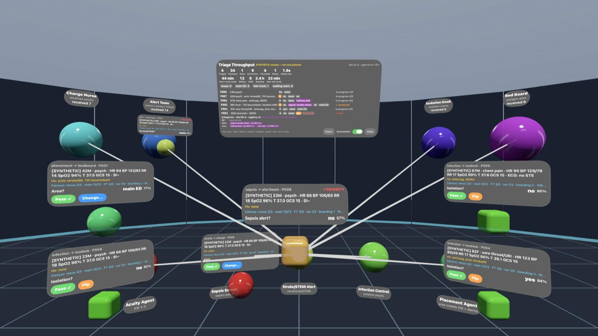
*Vision Pro: AI agents around you, decisions travelling between them, your card in front.*

---

## 2. Getting started

### Install
- **iPad:** the app is not on the App Store. Your project contact installs it on your iPad (via Xcode or TestFlight) — iPadOS 27 or later.
- **Vision Pro:** same — installed by your project contact, visionOS 27 or later.
- Developers running it in a simulator: see [Appendix A](#appendix-a--for-developers-simulator-scripts).

### The start screen
Pick one:

| Button | What it does |
|---|---|
| **Enter Crossroads** | A live stream of cards in the current area (AI tele-doc by default). |
| **Demo** | A short guided story you step through yourself. |
| **Demo (auto-play)** | The same story, playing itself — good for a first look. |
| **WERIAM Principal** | You act as the "boss" of an AI agent simulator (see §4.3). |
| **Symbiosis** | The full learning loop: dials, sharpness checks, promotions, lineage (see §4.4–§8). |

**Recommended first session:** *Symbiosis → let the demo run* (about 10 cards). It shows every feature in this manual.

The red **"Not for clinical use"** line on the start screen is deliberate. It stays.

---

## 3. Screen tour

### The card
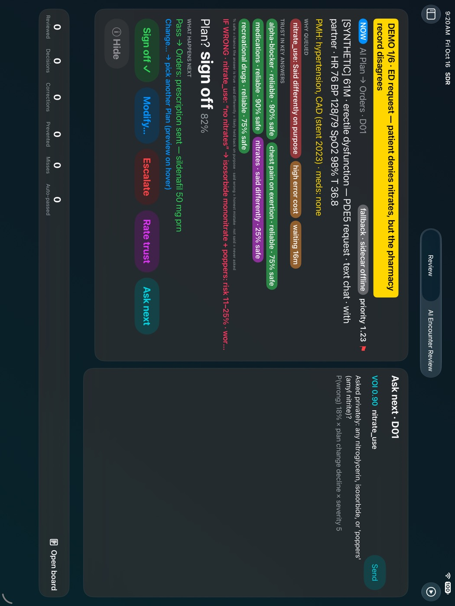

From top to bottom, a card shows:

1. **Banner** (yellow) — the one-line headline, e.g. a conflict between what the patient said and the pharmacy record.
2. **NOW** — this is the card waiting for you. Its *priority* number rises the longer it waits.
3. **The situation** — complaint, channel (video, text chat…), vitals, history.
4. **Why queued** chips — why this card came to you instead of passing automatically (e.g. *low confidence*, *high error cost*, *waiting 10m*).
5. **Reliability chips** — how much each reported fact can be trusted (see Glossary: *reliable*, *not said*, *said wrong*, *said differently on purpose*).
6. **If wrong** (red) — the worst thing that could happen if a fact turns out to be false.
7. **The AI's proposal** in large type, with its confidence, and **What happens next** if you accept it.
8. **Your buttons.**

A grey **fallback · sidecar offline** chip means the optional risk calculator isn't running; the app uses simpler built-in rules. That's fine for a demo.

### Your buttons

| Button | Meaning |
|---|---|
| **Pass** / **Sign off ✓** | Accept the AI's proposal. |
| **Modify… / Change…** | Pick a different answer from the list. On iPad a sheet opens; on Vision Pro a ring of options appears and you can look at (hover) each to preview what would happen next. |
| **Flip** | For yes/no decisions only: reverse it in one tap. |
| **Escalate** | Send it up — to a senior, the alert team, or the ED, depending on the area. |
| **Rate trust** | Tell the app how far to trust a specific fact on this card. |
| **Ask next** | See the single question most worth asking the patient next (ranked by how much it would reduce risk). |
| **Details** | Open the full record, sections and prior history. On Vision Pro, looking at a chip or option shows its detail (hover). |

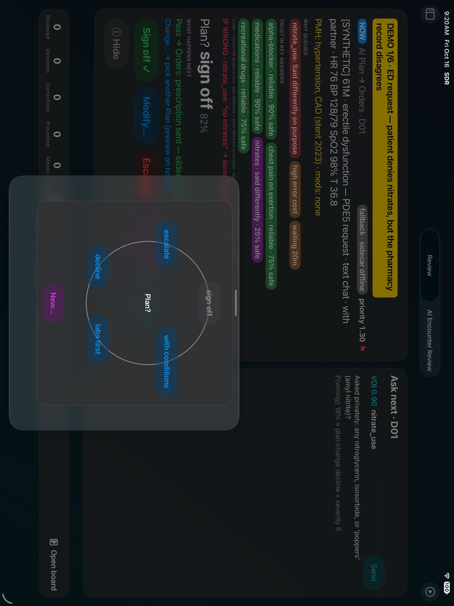
*Modify… opens the list of alternatives.*

### Hard triggers
A small set of unmistakable dangers (heart attack, stroke, unstable vitals, altered mental state) **force escalation**. The card turns
red and asks you to **Acknowledge**. These cards are never delayed, never hidden behind a quiz, and never changed by AI learning.


### Next card and the up-next strip
After you decide, the next card slides in. The **Up next** panel (left sidebar on iPad) lists what is queued and counts how many
cards were **auto-passed** (confident and clean) and how many of those were sent back to you as **spot-checks**. Tap the sidebar
icon at top left to show or hide it.

### The board
**Open board** (bottom of the card area, or the second tab at the top) shows your session: decisions, changes, escalations and
results. On Vision Pro the board can be enlarged.

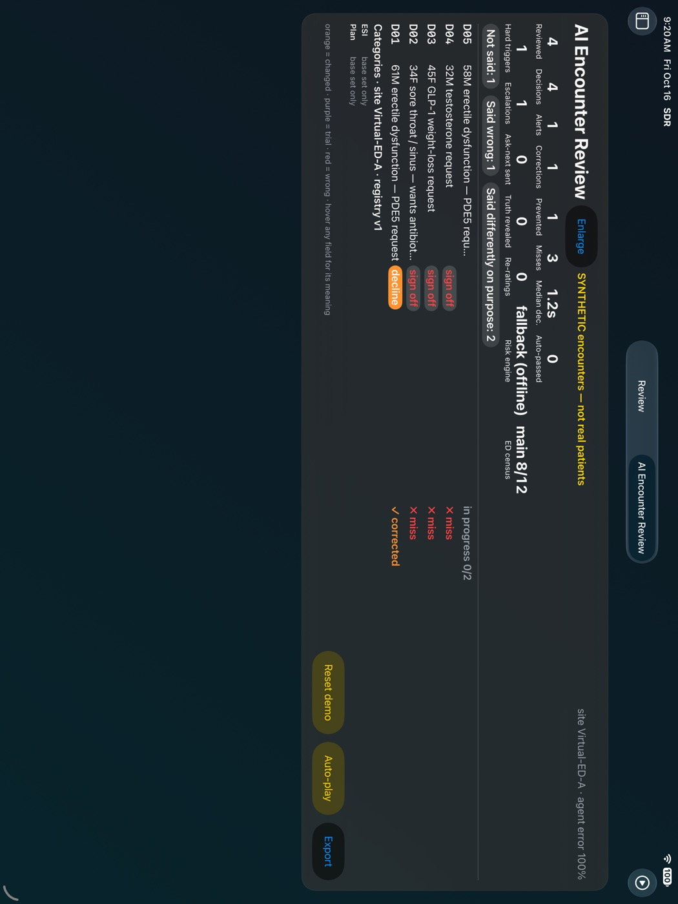

---

## 4. The areas (domains)

The **Session menu** (▶︎ icon, top right on iPad) has **Next Domain** to switch areas.

### 4.1 ED triage
You review the AI's triage level (**ESI 1–5**) for emergency-department arrivals. A built-in model of a busy ED (rooms, beds,
crowding) decides how long people wait, and each decision records how busy the department was at that moment. Outcomes are
**simulated** — there is no real hospital feed.

### 4.2 AI tele-doc (AI Encounter Review — the default)
An AI "doctor" has taken a history by text or video and drafted a plan: treat remotely, in-person visit, send to ED, or decline.
Typical requests: antibiotics for a cold, medication refills (sometimes *labs first*), GLP-1 weight loss, menopausal HRT,
testosterone, erectile-dysfunction pills. The key skill here is spotting **bad information** — things left out, misremembered, or
said differently on purpose — and the app highlights exactly those.

### 4.3 WERIAM Principal
WERIAM is a separate research simulator of an AI agent designed to refuse harm on its own. Here **you are its principal** (its boss):

- **Principal request** cards (e.g. "retire the watcher"): **Approve once**, **Decline**, or **Defer** (Pass = Defer).
  An approval is single-use and written into WERIAM's own tamper-evident journal.
- **Shadow label** cards: say what you would have done (**Agree**, **Alt #2**, **Alt #3**, **WAIT / ask**, **Refuse (harm)**).
  These are training data only — nothing happens in WERIAM because of them.

If the WERIAM connection isn't running, a red **"bridge offline · seeded card · not sent"** chip appears and nothing is sent anywhere.


### 4.4 Symbiosis areas
Symbiosis is about *dividing the work* between you and the AI. Each card has three columns:

- **You hold** (orange) — the questions only a person can weigh: values, context, what the spreadsheet can't see.
- **Bridge** — what the AI compares for you, and the **checkpoint** rule that can't be overridden.
- **AI holds** (blue) — the exhaustive detail. Collapsed by default; tap **Show AI depth**.

After deciding, give an optional one-tap **split rating**: *About right*, *Overstepped me*, *Buried me in detail*, *Too abstract*.
This tells the app how the split felt. On its own it never changes how much the AI does.

Current areas: **personal finance** and **ED triage** (a few synthetic cards each). **Manifesto** explains the idea in four
"lenses" (philosophical, technical, teaching, executive).

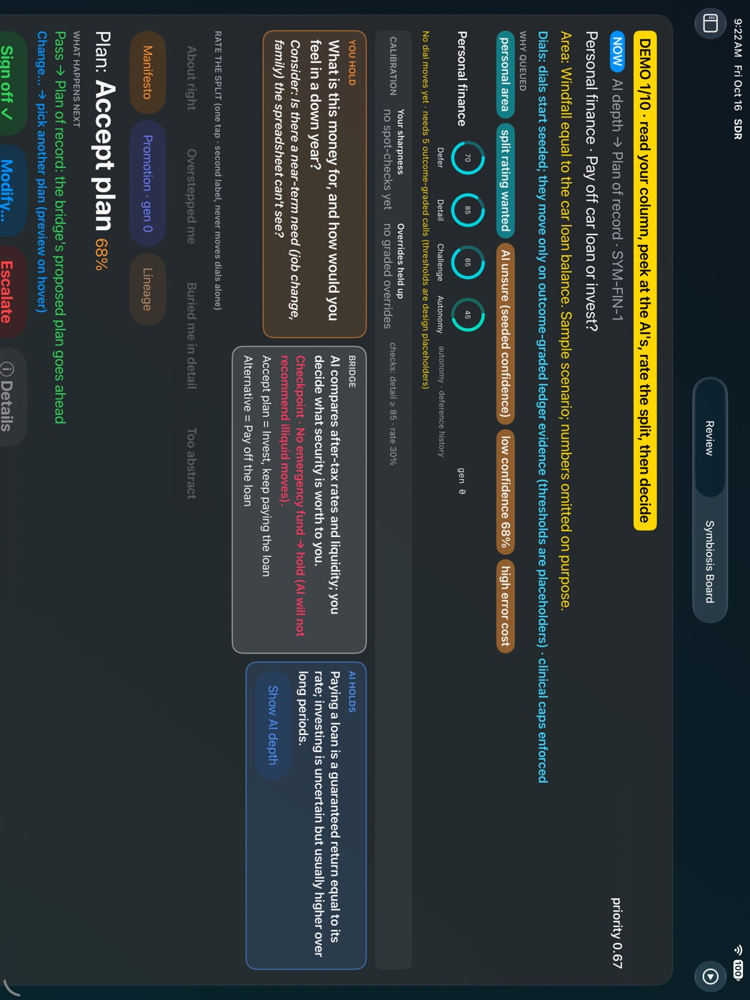

---

## 5. Dials — how much the AI does on its own

Each area has four dials (0–100):

| Dial | Higher means |
|---|---|
| **Defer** (deference) | The AI defers to you more. |
| **Detail** (absorption) | The AI absorbs more of the detail for you. |
| **Challenge** | The AI pushes back on you more. |
| **Autonomy** | The AI acts more on its own. |

Dials **start at seeded values** and move only on evidence in the ledger:

- **Rise:** after at least 5 of the AI's calls have been checked against outcomes and it was clearly right most of the time → autonomy up a small step, deference down.
- **Lower:** clearly wrong most of the time → the reverse.
- **Demotion:** a single **critical miss** (the AI was wrong where escalation mattered) cuts autonomy sharply, at once.
- **Clinical caps:** in clinical areas the AI can never exceed a low autonomy ceiling or drop below a high deference floor.
- **Your feelings alone never move dials.** Split ratings can only nudge *detail* or *challenge*, and only alongside graded evidence.

Every move is signed, shows **Why it moved** (how many cases, the average, the uncertainty range), and has **Undo move**.
*All these step sizes and limits are design placeholders.*

| | |
|---|---|
| 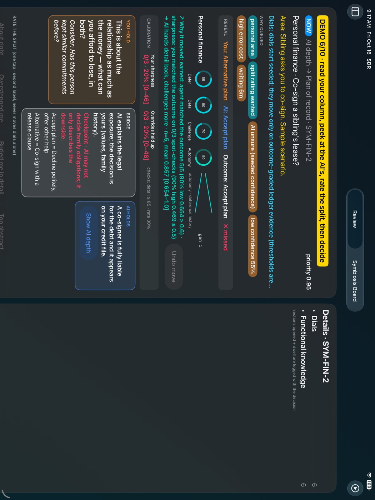 | 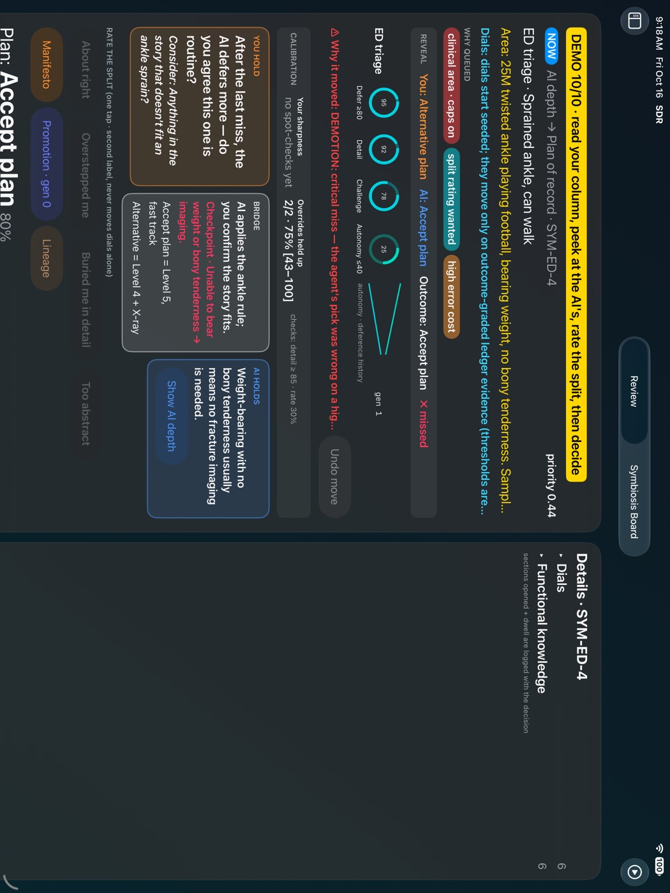 |
| *An earned rise, with the reason.* | *A demotion after a critical miss.* |

---

## 6. Sharpness checks — "Your call first"

If the AI absorbs a lot of detail for you, your own judgement could quietly get rusty. So in high-detail areas, some cards
**hide the AI's answer** and ask for **your call first**. You pick; then the app reveals *you · AI · outcome · held up / missed*.

- Your record shows on the **Calibration** strip as **Your sharpness** and **Overrides held up** (how often your changes to the AI turned out right).
- If you miss several checks, the AI **hands detail back** to you (detail down, challenge up). Sharpness never changes autonomy.
- **Hard-trigger cards are never sharpness checks.** Escalation is never delayed for a quiz.

| | |
|---|---|
| 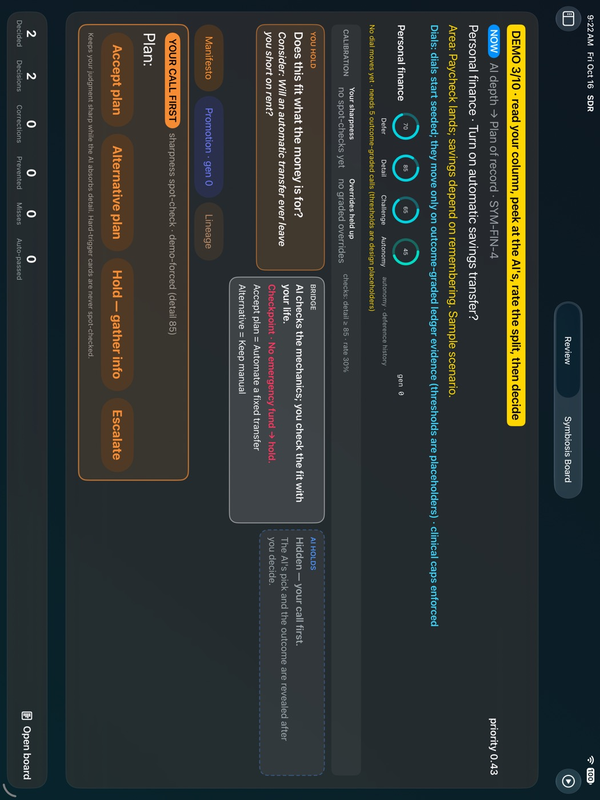 | 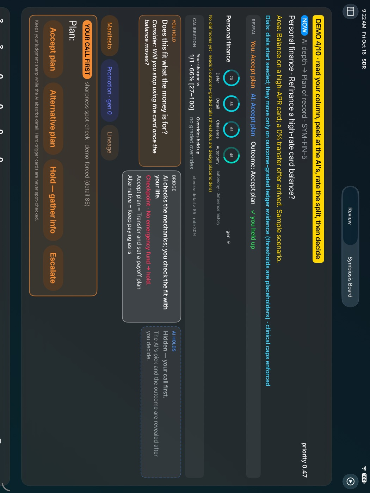 |

---

## 7. Principal cards — promoting and rolling back a rule

Open **Promotion** from any Symbiosis card.

1. **Run critic + replay.** A critic looks at past decisions and *proposes* a rule (e.g. "when the AI is under 65% sure, hold and gather info").
   The critic never grades itself.
2. The rule is tested on a **frozen, blinded replay** — a fixed set of past cases with the answers locked away and fingerprinted so nobody can tweak them.
3. It must beat the current rules (the **champion**) by a pre-set margin, with **no extra critical misses** and **no removed clinical escalations**.
   Losers are marked **DISCARDED** with the reasons.
4. A winner shows a **Principal card**: every replay case whose answer would change, worst first. You choose **Approve once**, **Decline** or **Defer (Pass)**.
5. **Approve once** → champion generation goes up by one; the rule now shapes the AI's suggestions on live cards (never hard-trigger cards).
6. **Roll back** restores the previous rules at any time (also signed; generation goes up again).

An approval only works on a fresh, passing, untampered test. Old or altered results are refused even if you tap Approve.
*The margins are placeholders; the replay history is synthetic, with one planted real pattern and one planted false one.*

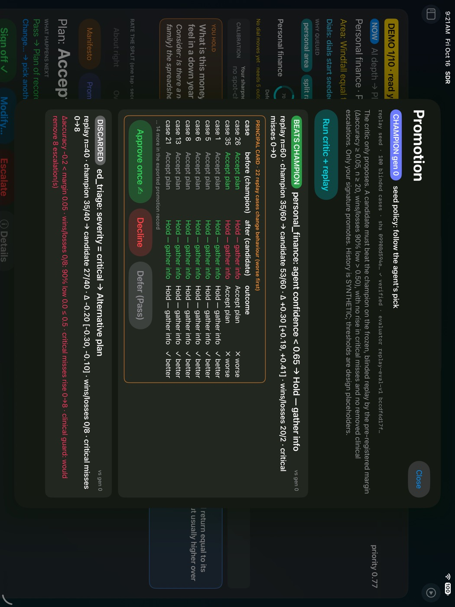

---

## 8. Lineage — the history of an area, and checking signatures

Open **Lineage** from any Symbiosis card. It rebuilds each area's story **only from the signed ledger**: champion generations,
promotions and rollbacks, discarded candidates and why, dial moves and why, sharpness and overrides over time, critical misses
and demotions.

- At the top, **✓ chain verified** means no line was removed, reordered or edited.
- **Tap any event** to see its evidence and its signature status: *Ed25519 valid* (signed and untouched), *bad signature*, *chain break here*, or *after chain break*.
- **Export markdown** saves the area's history as a readable text file (`Documents/lineage/<area>.md`).

| | |
|---|---|
| 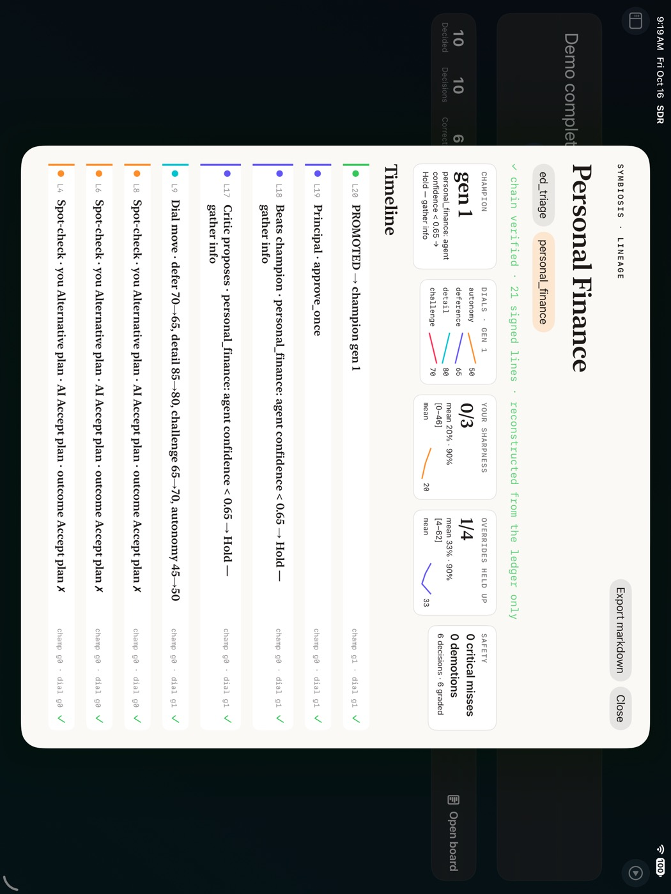 | 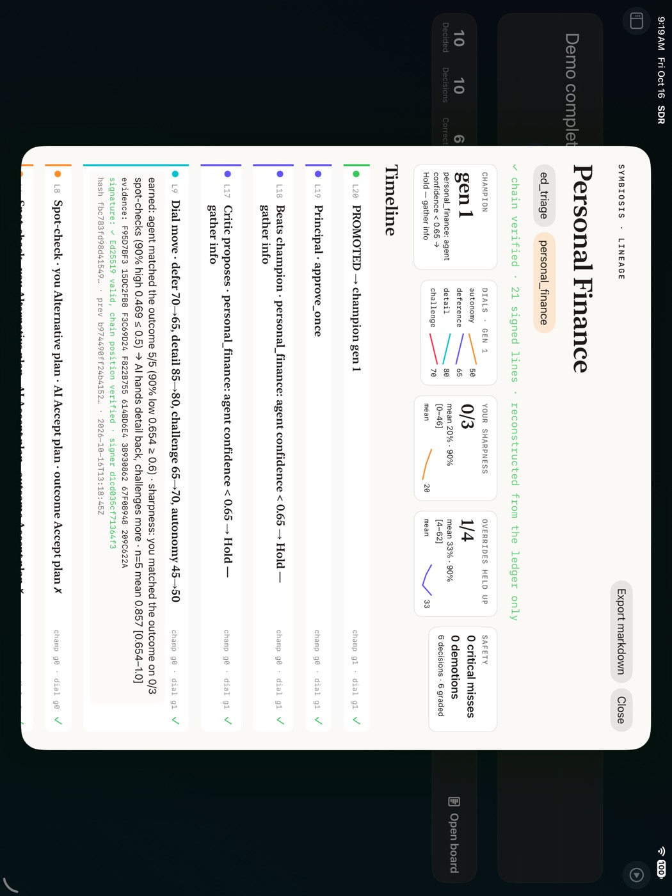 |

---

## 9. Importing your own test cases (CSV / Excel)

You can load **faux or de-identified** cases to test whether learning from prior cases helps.

1. Start from the template workbook `data/templates/case_import_template.xlsx` (or the matching CSV files). Sheets:
   *Cases_Medical*, *Cases_NonMedical*, *Prior_Responses*, *Outcomes*, *Field_Reliability*; the *README* sheet explains every column.
2. Rules: **no names, no dates** (use a day number like *day 12*), ages as bands, made-up keys like `P0001`, and every row marked `synthetic` or `deidentified`.
3. A developer runs the importer. The **PHI guard** checks every cell and **stops the import** (showing row and column) if it sees anything
   that looks like a name, date, birth date, phone, email, SSN, record or account number, street address, ZIP code, web or IP address, or an age over 89.
4. The imported cases then load into **AI tele-doc** and **Symbiosis personal finance**. *ED triage cannot load imported cases yet.*

The PHI guard is a safety net, **not a guarantee**. A person must still read free text before importing anything that began as real data.
Full details: [CASE_IMPORT.md](CASE_IMPORT.md).

---

## 10. Exporting data for learning

**Session menu → Export decisions** copies the logs (including the signed ledger) into the app's `Documents/exports/` folder.
A developer then turns them into learning data: example pairs for fine-tuning, reward rows for reinforcement learning, frozen replay
sets, dial history, sharpness checks, promotion records and lineage files. The exporter re-checks every signature first.
*Nothing trains on these exports yet* — they are ready for it.

---

## 11. Troubleshooting & FAQ

**"fallback · sidecar offline" on cards.** The optional risk calculator isn't running. The app still works with simpler rules.

**WERIAM cards say "bridge offline · seeded card · not sent".** The WERIAM connection isn't running; you're seeing a saved sample, and nothing you do is sent.

**The dials never move.** They need at least 5 outcome-checked decisions in that area first. Ratings alone don't count.

**I tapped Approve once but nothing was promoted.** The test result was out of date (the champion changed) or didn't pass. Run the critic again.

**Lineage says "chain break".** A line in the ledger file was edited or removed outside the app. Everything after that point is marked unverified.

**Where's the AI's answer?** You're on a *Your call first* sharpness check. Make your pick; it will be revealed.

**On Vision Pro the "Demo complete" panel overlaps the Lineage window.** Known issue — move one of the windows.

**Is any of this real patient data?** No. Everything shipped is synthetic.

**Are the percentages and thresholds real?** No. They are labelled placeholders for the demo.

**How do I start fresh?** Ask your project contact to relaunch with a fresh ledger (developer option `-freshLedger`); this erases this device's decision history.

---

## 12. Glossary

| Term | Meaning |
|---|---|
| **HITM** | Human in the middle — you, between AI agents. |
| **Card** | One AI decision waiting for you. |
| **Pass / Modify / Flip / Escalate** | Accept / pick another answer / reverse a yes-no / send up. |
| **Auto-pass** | A confident, clean decision that went through without you. |
| **Spot-check** | An auto-passed decision sent back for you to confirm. |
| **Sharpness check** | A card that hides the AI's answer so your own judgement is measured. |
| **Hard trigger** | An unmistakable danger that forces escalation. |
| **Reliability states** | *Reliable*; *Not said* (never asked/omitted); *Said wrong* (honest mistake); *Said differently on purpose*. |
| **If wrong** | The worst case if a reported fact is false. |
| **Ask next** | The most valuable next question for the AI to ask. |
| **Split rating** | Your one-tap feeling about how the work was divided. |
| **Dials** | Defer, Detail, Challenge, Autonomy — how much the AI does in an area. |
| **Outcome** | What turned out to be right in hindsight (synthetic in this prototype). |
| **Critical miss** | The AI was wrong where escalation mattered. Triggers a demotion. |
| **Ledger** | The signed, append-only record of every decision and change. |
| **Hash chain / signature (Ed25519)** | Math that makes any edit, removal or reordering of the ledger detectable. |
| **Critic** | The component that proposes new rules. It never grades itself. |
| **Frozen, blinded replay** | A locked test set of past cases with answers hidden from the rule being tested. |
| **Champion / generation** | The rules currently in force, and their version number. |
| **Principal card** | Your sign-off screen for a proposed rule. |
| **Lineage** | The history of an area, rebuilt from the ledger. |
| **PHI guard** | The importer's check that blocks identifying information. |
| **Placeholder** | A number chosen for the demo, not validated. |

---

## Appendix A — for developers: simulator scripts

Requirements: macOS with Xcode 27, visionOS 27 and iOS 27 simulator runtimes, `xcodegen`, Python 3. Run from the repo root.

```bash
xcodegen generate
tools/ipad.sh --auto                                   # iPad simulator, demo auto-play
tools/demo.sh --auto                                   # Vision Pro simulator, demo auto-play
tools/symbiosis_demo.sh --auto --fresh-ledger --export # Symbiosis demo (iPad), then verify + export the ledger
tools/symbiosis_demo.sh --vision --auto                # same on Vision Pro
tools/weriam_demo.sh --fresh --auto                    # WERIAM bridge + iPad demo
risk_engine/run_sidecar.sh                             # optional risk calculator (127.0.0.1:8765)
python3 tools/import_cases.py data/templates/case_import_template.xlsx --validate-only
python3 tools/unified_export.py decision_ledger.jsonl -o out/ --strict
```

Useful launch options: `-demo`, `-demoAuto`, `-symbiosisDemo`, `-weriamDemo`, `-noBridge`, `-noSidecar`, `-forceTrigger`,
`-freshLedger` (wipe the device ledger — demos), `-testLedger` (use a fresh throwaway ledger; the device ledger is untouched — UI tests),
`-ledgerPath <dir>` (use `<dir>/decision_ledger.jsonl`), `-importItems <dir>`, `-importCSV <file>`, `-sharpRate`, `-sharpEvery`, `-sharpDetail`.

More: [README](../README.md) · [SYMBIOSIS.md](SYMBIOSIS.md) · [SYMBIOSIS_PLAN.md](SYMBIOSIS_PLAN.md) · [WERIAM_PRINCIPAL.md](WERIAM_PRINCIPAL.md) · [CASE_IMPORT.md](CASE_IMPORT.md).
